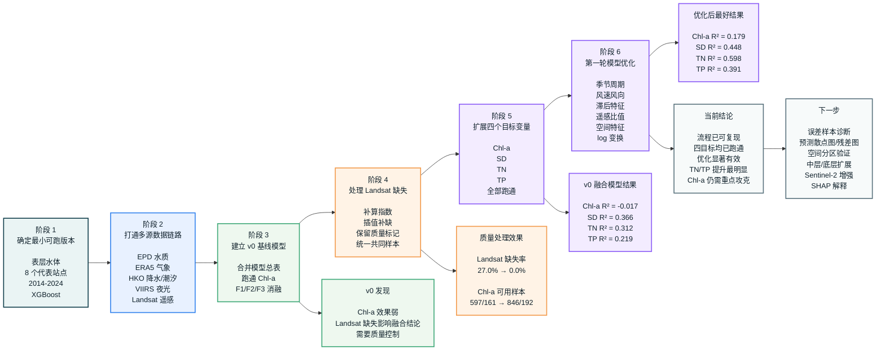

# 香港近岸水质预测项目：迭代路线图（优化版）

> 结构原则：一条主线、六个阶段、每阶段只保留“做了什么 → 得到什么 → 说明什么”。



## 一页版汇报逻辑

```text
1. 先收缩问题：表层、8 站点、2014-2024、XGBoost
2. 再打通数据：EPD + ERA5 + HKO + VIIRS + Landsat
3. 跑出 v0：能建模，但 Chl-a 弱，Landsat 缺失影响结论
4. 做质量控制：Landsat 缺失率从 27.0% 降到 0.0%，样本数明显增加
5. 扩展目标：Chl-a / SD / TN / TP 全部跑通
6. 做特征优化：季节、风场、滞后、遥感比值、空间特征、log 变换
7. 得到提升：四个目标 R² 均改善，TN/TP 提升最明显
8. 下一步：误差诊断、空间验证、中底层、Sentinel-2、SHAP
```

## 当前最适合写进汇报的成果句

```text
本阶段已建立香港近岸表层水质多源融合预测的可复现 v0 流程，并完成从数据质量控制、共同样本消融到四目标变量优化建模的完整迭代。结果表明，Landsat 缺失处理和滞后/空间特征显著改善模型表现，其中 TN 和 TP 的预测提升最明显，SD 表现稳定，Chl-a 仍是后续重点优化对象。
```

