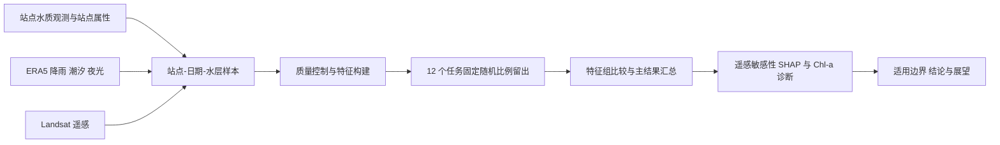

# 本文论文大纲与图表清单

## 一、当前版本说明

- 本大纲与 `福州大学格式论文草稿_香港近岸多水层水质预测_随机比例划分_20260905.docx` 一致，是当前正文的组织依据。
- 正式结果采用固定随机比例留出：每个“指标—水层”任务按 80% 训练、20% 测试随机划分，`random_state=42`。
- 正式结论只能表述为同分布留出样本预测表现，不能替代未来年份时间外推或留站点空间外推结论。
- 正式模型不使用同日其他水质指标。当前正式主表实际进入模型的遥感信息为 Landsat 特征；Sentinel-2、连续空间制图和分海区建模均不作为本论文正式主结果。

## 二、建议题目

**多源数据融合下香港近岸多水层水质预测及遥感信息敏感性分析**

题目长度符合研究对象、方法和核心分析对象；不宜在题目中承诺“时间外推预测”或“连续空间制图”，因为这两项目前并非正式评价结论。

## 三、论文整体逻辑

## 四、正文大纲

### 第 1 章 绪论

#### 1.1 研究背景与意义

- 香港近岸海域受陆源输入、潮汐交换、气象扰动和人类活动共同影响，水质具有明显的时空异质性和垂向差异。
- Chl-a、Secchi、TN 和 TP 分别表征藻类生产、光学水质状态和营养盐状况，是近岸水环境评价的重要指标。
- 站点监测具有垂向信息优势，遥感具有空间覆盖优势；二者与过程驱动数据的协同作用需要通过统一实验验证。

#### 1.2 国内外研究现状

1. 近岸与河口水质预测研究进展。
2. 历史滞后与环境过程驱动的水质预测研究。
3. 遥感反演及遥感辅助水质预测研究。
4. 多水层水质预测与可解释机器学习研究。
5. 研究现状小结与本文问题定位。

#### 1.3 研究问题、内容与技术路线

1. 不使用同日其他水质指标时，历史惯性和环境过程信息对四指标三水层预测的贡献有多大？
2. Landsat 遥感信息在不同指标和水层中是否提供稳定增益，其适用边界是什么？
3. 为什么 Chl-a 的预测表现相对较低，短期扰动与高值样本如何影响模型误差？

**本章图表**

| 编号 | 图表内容 | 作用 |
| --- | --- | --- |
| 图 1-1 | 研究技术路线 | 说明数据、模型与结果解释链路 |
| 图 1-2 | 科学问题与章节关系 | 将研究问题对应到后续证据章节 |

### 第 2 章 研究区、数据与样本构建

#### 2.1 研究区与监测网络

- 香港近岸 94 个监测站点、海区分布及三水层观测结构。

#### 2.2 多源数据与目标变量

- 2014-2024 年 Chl-a、Secchi、TN、TP 的观测数据。
- 站点空间属性、ERA5、降雨、潮汐、夜间灯光和 Landsat 遥感特征。
- 数据时间范围、单位、样本量、缺失与分布特征。

#### 2.3 样本定义、匹配与质量控制

- `sample_id` 为站点—日期，`obs_id` 为站点—日期—水层。
- 多源数据按站点与日期键匹配；遥感数据使用质量字段记录覆盖状况。
- 同日其他水质指标不进入正式特征表；仅允许使用目标变量自身的历史滞后和采样日前可获得的外部信息。

**本章图表**

| 编号 | 图表内容 | 作用 |
| --- | --- | --- |
| 图 2-1 | 监测站点与海区分布 | 展示研究区和空间覆盖 |
| 图 2-2 | 三水层观测覆盖 | 说明水层样本结构 |
| 图 2-3 | 四项水质指标三水层分布 | 展示目标变量偏态与层间差异 |
| 图 2-4 | 水质观测时间覆盖 | 展示 2014-2024 年样本时间分布 |
| 图 2-5 | 多源数据接入与样本主键 | 说明可追溯的匹配关系 |
| 表 2-1 | 海区与站点空间覆盖统计 | 量化站点和海区数量 |
| 表 2-2 | 多源数据来源与用途 | 说明各数据源的机制作用 |
| 表 2-3 | 目标变量描述性统计 | 报告单位、样本量、范围与分布 |
| 表 2-4 | 遥感与短时间窗过程特征覆盖 | 说明可用性和质量约束 |

### 第 3 章 方法与随机留出验证设计

#### 3.1 预测任务与特征组

- 四项指标、三水层，共 12 个任务。
- 基线组、历史与过程组、遥感组、历史—遥感融合组用于分离信息来源的作用。

#### 3.2 固定随机比例留出与防泄漏原则

- 每个任务独立随机划分 80% 训练集和 20% 测试集，随机种子固定为 42。
- 不使用同日 TN、TP、浊度、盐度、DO、pH 等水质协变量。
- 目标变量采用 `log1p` 变换；评价使用 R2、RMSE、MAE、NSE。

#### 3.3 模型与比较口径

- 使用固定参数的 XGBoost 回归模型。
- 所有特征组在同一任务、同一划分下比较，避免将特征差异与划分差异混为一谈。

**本章图表**

| 编号 | 图表内容 | 作用 |
| --- | --- | --- |
| 图 3-1 | 固定随机比例的训练集与测试集划分 | 明确评价口径与适用边界 |
| 表 3-1 | 十二个预测任务与样本量 | 交代任务构成与数据基础 |
| 表 3-2 | 正式模型特征组定义 | 交代消融比较设计 |

### 第 4 章 多水层水质预测结果

#### 4.1 总体预测表现与最佳模型

- 12 个任务的最佳 R2 存在显著指标和水层差异。
- TN 表层、底层的最佳 R2 分别为 0.798 和 0.602；TP 表层和中层分别为 0.725 和 0.582；Secchi 表层为 0.616。
- Chl-a 表层、中层和底层的最佳 R2 分别为 0.465、0.403 和 0.374。

#### 4.2 特征组比较

- 历史与过程组及融合组整体优于基线组。
- 遥感单独组总体偏弱，说明遥感信息在本研究中是条件性补充，而非独立替代过程信息。

#### 4.3 指标与水层差异

- 营养盐和透明度任务在随机留出条件下表现相对较好。
- Chl-a 对短期光照、风浪、潮汐和局地水动力更敏感，误差更大。

**本章图表**

| 编号 | 图表内容 | 作用 |
| --- | --- | --- |
| 图 4-1 | 十二个任务预测性能热图 | 总览指标和水层差异 |
| 图 4-2 | 不同特征组总体性能比较 | 量化多源信息贡献 |
| 图 4-3 | 最佳模型观测值与预测值对比 | 直观展示拟合与误差 |
| 表 4-1 | 十二个任务正式随机留出结果 | 给出 48 组模型的完整指标 |
| 表 4-2 | 各任务最佳正式模型 | 汇总正文核心结果 |

### 第 5 章 遥感敏感性与不确定性讨论

#### 5.1 遥感质量覆盖与融合增益

- 说明正式主表中 Landsat 特征的覆盖、有效像元和缺失限制。
- 比较遥感融合相对历史与过程组的任务级 R2 变化，允许报告负增益或有限增益。

#### 5.2 实际可用遥感特征的可解释性

- 使用 SHAP 解释已实际进入融合模型的遥感变量。
- 不将表面遥感解释为中层和底层水质的直接观测。

#### 5.3 Chl-a 误差结构与研究局限

- 分析代表站点时间序列、观测—预测散点、月尺度残差、高值样本误差和特征重要性。
- 将 Chl-a 的困难归因于短期扰动、采样时间分辨率和垂向不可见性，不夸大遥感贡献。

**本章图表**

| 编号 | 图表内容 | 作用 |
| --- | --- | --- |
| 图 5-1 | 正式主表遥感质量覆盖 | 说明遥感使用基础 |
| 图 5-2 | 融合模型遥感特征构成 | 说明实际进入模型的字段 |
| 图 5-3 | 遥感融合任务级增益 | 判断遥感是否稳定提升 |
| 图 5-4 | 不同水层遥感融合增益分布 | 比较水层差异 |
| 图 5-5 | 遥感特征 SHAP 重要性 | 解释变量相对贡献 |
| 图 5-6 | 遥感主要特征 SHAP 依赖关系 | 展示非线性响应 |
| 图 5-7 | Chl-a 表层代表站点时间序列 | 展示短期波动 |
| 图 5-8 | Chl-a 表层观测值与预测值散点图 | 展示整体偏差 |
| 图 5-9 | Chl-a 表层月尺度残差变化 | 识别时间误差结构 |
| 图 5-10 | Chl-a 表层主要特征重要性 | 解释困难任务的驱动信息 |
| 表 5-1 | 遥感与短时间窗过程特征质量覆盖 | 量化质量约束 |
| 表 5-2 | 融合模型遥感特征构成 | 对应可解释性图件 |
| 表 5-3 | 遥感融合增益判定 | 给出任务级对比结果 |
| 表 5-4 | Chl-a 表层自相关与峰值波动统计 | 说明历史惯性与峰值难度 |
| 表 5-5 | Chl-a 表层高值样本误差统计 | 说明高值误差边界 |

### 第 6 章 结论与展望

#### 6.1 主要结论

按“数据体系—12 个任务预测结果—遥感敏感性—Chl-a 误差边界”归纳，不只罗列模型分数。

#### 6.2 研究贡献

1. 构建香港近岸 94 站点、四指标、三水层的可复现多源预测样本和模型链路。
2. 通过固定随机比例留出和特征组比较，分离历史惯性、环境过程和实际可用遥感信息的作用，避免同期水质变量泄漏。
3. 量化 Landsat 遥感辅助预测在不同指标和水层中的有限、任务依赖型增益，并以 SHAP 与 Chl-a 诊断说明适用边界。

#### 6.3 研究不足与展望

- 补充采样时刻、河流径流与排放、垂向温盐流速等关键过程数据。
- 在新数据进入正式主表后，再开展严格近同日 Sentinel-2 与 Landsat 质量匹配的敏感性实验。
- 以时间阻塞和留站点空间外推验证为前提，探索分海区模型和连续空间制图。

**本章图表**

| 编号 | 图表内容 | 作用 |
| --- | --- | --- |
| 表 6-1 | 主要结论与对应证据 | 将结论对应到结果章节 |
| 表 6-2 | 数据缺口与后续改进方向 | 界定未来工作边界 |

## 五、福州大学格式执行要点

- 页面为 A4；上、左页边距 2.5 cm，下、右页边距 2.0 cm。
- 正文章节使用黑体，正文使用宋体，西文和数字使用 Times New Roman；全文文字为黑色。
- 图题置于图下，表题置于表上；图表按章节连续编号；跨页结果表重复首行表头。
- 前置部分依次包括封面、声明、中文摘要、英文摘要、目录和主要符号表；正文后包括参考文献、附录和致谢。
- 封面身份信息、学校统一声明页、参考文献和最终目录须在送审前以学院最新模板与实际材料补齐。
